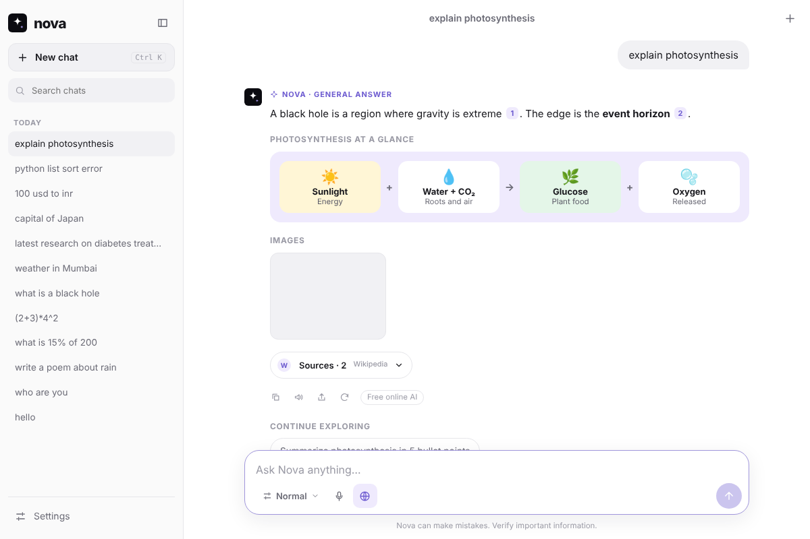
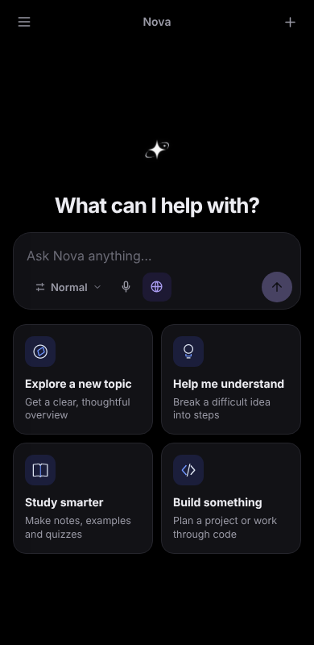

<div align="center">

# ✦ Nova

**A free, open-source, privacy-first AI research assistant — installable as a PWA and an Android app.**
No account · No subscription · No paid APIs · Works offline

</div>

<p align="center"> </p>

## What's new in 1.4
Full-page Settings, 10 accent colours that re-theme the whole app and logo, a Google / DuckDuckGo / Bing / Brave switcher on the globe button, private chats, saved-answer collections, cricket scores and Panchang, and a slimmer floating chat bar. See [CHANGELOG](CHANGELOG.md).

## What's new in 1.3
New logo, Deep Research, answer styles, voice in/out, Hinglish search, Google grounding (via your free Gemini key) and a "Search on Google" button, photo/PDF/link questions, private library, study mode, share cards. See [CHANGELOG](CHANGELOG.md).

## What's new in 1.2 — a research assistant that reads the live web (Android app)
In the **Android app** Nova uses the phone's *native* HTTP client, which has no browser CORS limits, so it needs **no backend and no proxy**:

1. **Search** — DuckDuckGo + Bing in parallel (plus Brave / Tavily if you add free keys), merged with reciprocal-rank fusion.
2. **Read** — opens the top pages, strips menus/ads/footers, keeps the article text.
3. **Rank** — splits pages into passages and picks the ones that best match the question (BM25).
4. **Answer** — your free AI (Gemini / Groq / OpenRouter key, on-device model, or free online) writes a cited answer from those passages.
5. **Recommend** — images from the pages + Commons/Openverse, YouTube videos you can play inside Nova, and "related searches" from Bing.

**Free-key wizard:** Settings → AI has one-minute setup cards for Gemini, Groq, OpenRouter and custom endpoints, each with a Test button. Add several: if one is busy or out of quota, Nova automatically falls back to the next. Because each person uses *their own* free quota, a public app never runs out for everyone at once.

> In a normal browser (PWA) websites block direct reading (CORS), so live web reading is Android-app-only; the PWA still uses the 38 knowledge databases.

## Features

- **Real AI answers, free.** Choose how Nova thinks (Settings → AI):
  | Mode | What it is | Cost |
  |---|---|---|
  | **On-device** | A small open model (SmolLM2, Qwen2.5, Llama 3.2) runs *in your browser* via [WebLLM](https://github.com/mlc-ai/web-llm)/WebGPU. Private; works offline after a one-time download. | Free |
  | **Free online** | Key-less community endpoint ([Pollinations](https://pollinations.ai)). Opt-in, clearly disclosed. | Free |
  | **Custom endpoint** | Any OpenAI-compatible URL: Ollama / LM Studio on your PC, or a free-tier key (Groq, Gemini, OpenRouter…). Key stays in your browser. | Free |
  | **Sources only** | No model. A cited summary assembled from the retrieved sources. | Free |
  | **Auto** *(default)* | Best available, with automatic fallback if a provider is down. | Free |
- **38 free databases, auto-routed per question** — nothing is called unless it is relevant, and Settings → Sources lets you switch any off:
  | Area | Databases |
  |---|---|
  | Encyclopedias | Wikipedia (14 languages), Simple English Wikipedia, Wikidata, Wikibooks, Wikiversity, Wikinews, Wikivoyage, Wikisource |
  | Web | DuckDuckGo Instant Answers, Marginalia (independent web index) |
  | Academic | OpenAlex, Crossref, Semantic Scholar, arXiv, DOAJ |
  | Medical | Europe PMC, PubMed, ClinicalTrials.gov, openFDA drug labels |
  | Books & archives | Open Library, Google Books, Project Gutenberg, Internet Archive, Library of Congress |
  | Code & tech | Stack Exchange, MDN, GitHub, npm, Hacker News |
  | Reference & data | Free Dictionary, Wiktionary, REST Countries, ECB exchange rates (Frankfurter), PubChem |
  | Live | Open-Meteo weather, GDELT news index |
  | Images | Wikimedia Commons, Openverse, NASA Image Library |
- **Feels like an assistant, not a search box.** Writing, translation, chat and "who are you" questions are answered directly with no lookup; factual questions are researched silently and answered in prose with `[n]` citations, with sources tucked behind one compact "Sources" pill. Short follow-ups ("and its capital?") inherit the previous topic.
- **Grounded & cited.** Answers use numbered sources from those databases, de-duplicated, ranked and diversified so no single site dominates. Click a `[1]` chip to preview a source or read it inside Nova (many sites forbid embedding; "Open original" always works).
- **Streaming**, stop button, regenerate, copy, share, read-aloud, voice typing, follow-up suggestions, Markdown/table/code rendering (sanitised).
- **Built-ins:** safe calculator (no `eval`), live weather, image search, offline explainers.
- **14 answer languages**, Hindi + English UI, light/dark/system themes.
- **Private by design:** chats live in IndexedDB on your device; JSON backup/restore; no analytics, no tracking, strict CSP.
- **PWA:** installable, offline app shell, auto-update prompt, maskable icons, app shortcuts.

## Test live web on your PC (no APK needed)
`npm run dev` starts a tiny **dev-only** proxy (`scripts/dev-proxy.mjs`) so the live-web pipeline also works on `http://localhost:5173`. In *Settings → Sources* you should see **Dev proxy: on**. For real AI answers add a free key in *Settings → AI* (Gemini or Groq, ~1 minute) — the keyless "Free online AI" is a best-effort community service and is often unavailable. The proxy is not included in production builds; the APK uses the phone's native HTTP instead.

## Quick start
```bash
npm install
npm run dev        # http://localhost:5173
npm test           # unit tests
npm run build      # production build → dist/ (also writes the service-worker precache list)
```

## Publish for free
### Web / PWA on GitHub Pages
1. Create a GitHub repo and push this project to `main`.
2. **Settings → Pages → Source: GitHub Actions.**
3. The `Deploy PWA to GitHub Pages` workflow publishes it at `https://<user>.github.io/<repo>/`. Open it on your phone and choose **Install app**.

### Android APK
**Actions → Build Android APK → Run workflow**, then download `Nova.apk` from the run (or push a `v*` tag for a GitHub Release). Details and alternatives in [docs/ANDROID.md](docs/ANDROID.md).

## Project layout
```
src/
  lib/research.js       pipeline: databases ∥ live web ∥ videos → read pages → rank passages
  lib/web.js            DuckDuckGo/Bing/Brave/Tavily search, page reader, BM25, YouTube
  lib/http.js           native (CORS-free) HTTP in the Android app, fetch() elsewhere
  App.jsx               state, answer pipeline (intent → search → engine → stream)
  components/           Sidebar, Composer, Message, Settings, Preview
  lib/providers.js      the source registry — add a database by appending one object
  lib/search.js         routing, parallel fetch, de-dup, ranking, diversification
  lib/ai.js             on-device / online / custom / extractive engines, prompt builder
  lib/calc.js           safe expression parser
  lib/db.js             IndexedDB store (+ migration from the old localStorage format)
  lib/markdown.js       marked + DOMPurify, citation chips
public/                 manifest, service worker, icons
scripts/                make-icons.mjs, postbuild.mjs (precache manifest + CSP)
.github/workflows/      ci.yml, pages.yml, android-apk.yml
```

## Honest limitations
- All 38 databases are free and key-less, but they are third-party services: some may rate-limit, change, or block browser (CORS) access. Nova fails soft and shows how many databases responded; switch off any that misbehave in Settings → Sources.
- Small on-device models are far less capable than large cloud models. Always check the cited sources for important decisions; Nova is not a substitute for professional advice.
- Free public APIs have rate limits and can change or go offline; Nova fails soft and falls back to a source summary.
- Free online AI sends your question and a few source snippets to a third party — don't type private data in that mode.
- Retrieval is lexical and Wikipedia-centred; it is not a full web index.
- Live web reading relies on public search pages (DuckDuckGo/Bing HTML, YouTube results). Their markup or bot-protection can change; Nova falls back to the other engines and the databases. Optional Brave/Tavily keys make search more robust.
- On-device AI needs WebGPU (recent Chrome/Edge; recent Android WebView). Otherwise use the online/custom modes.

## Contributing
Issues and PRs welcome. Run `npm test && npm run build` before submitting. MIT licensed — see [LICENSE](LICENSE).
